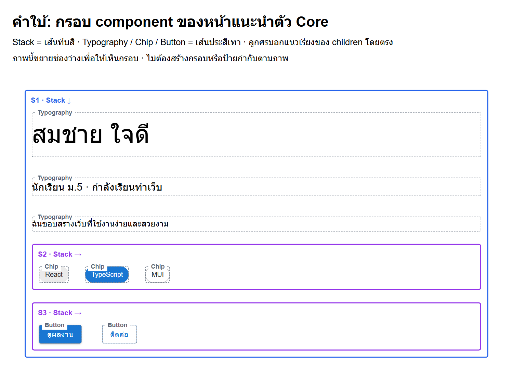
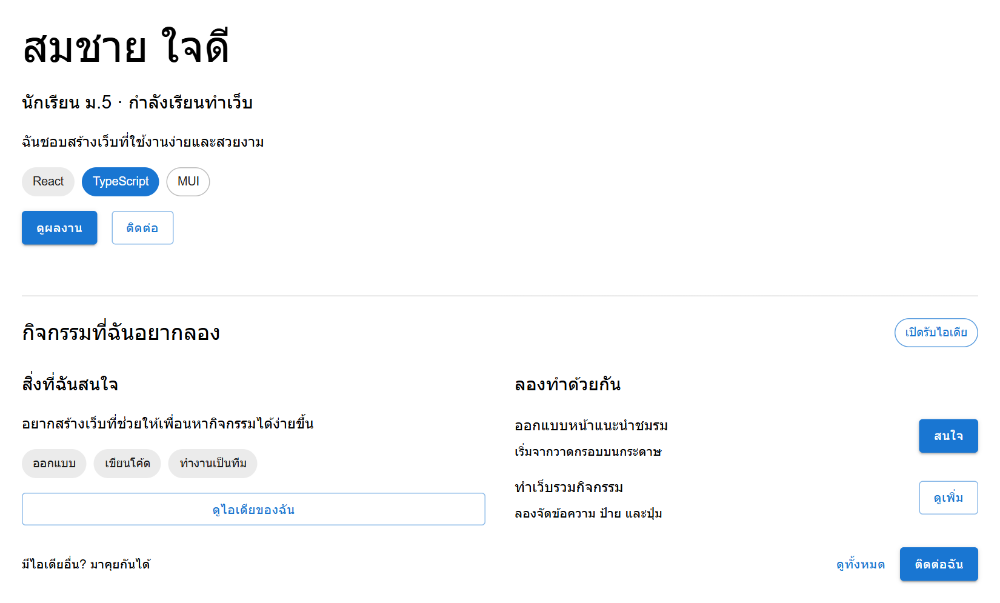
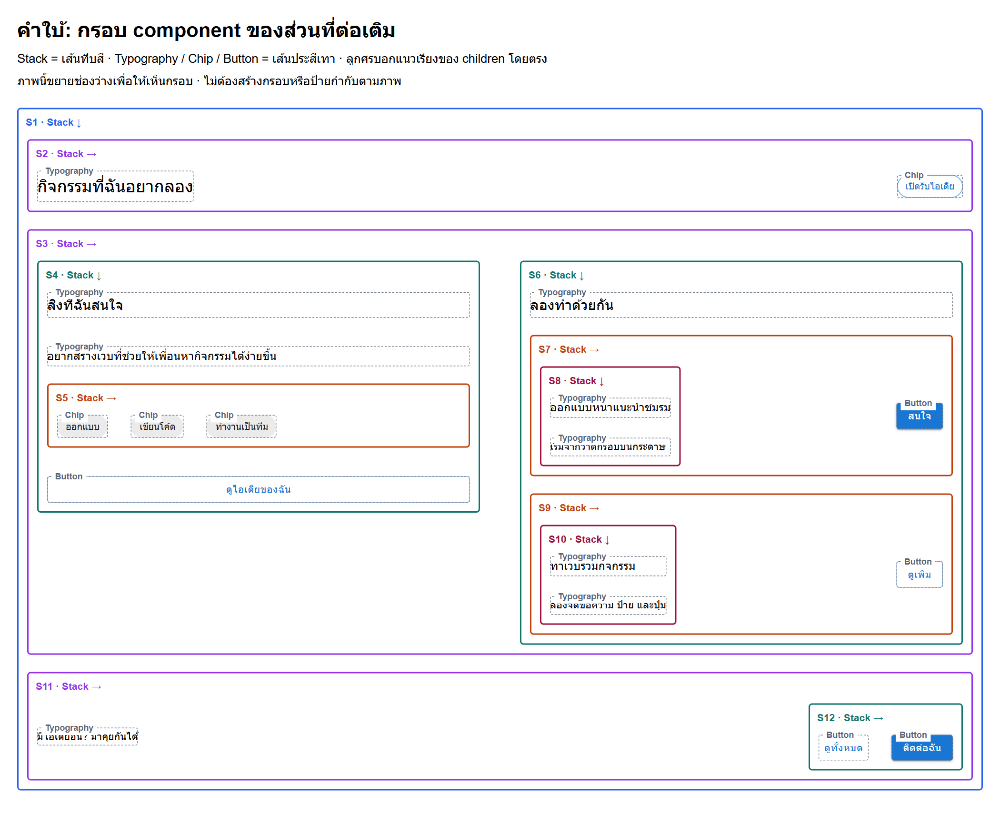

# งานสัปดาห์ 1

> ทุกข้อใน **Core** ต้องจบภายในคาบ ไม่มีการบ้าน ส่วน **Challenge** ทำหรือไม่ทำก็ได้ ไม่เก็บคะแนน

## คาบเดี่ยว (40 นาที) — วาด component และลอง Inspector

| # | งาน | เวลา |
|---|---|---|
| 1 | ฟังภาพรวมคอร์สและ 3 project | 10 |
| 2 | **Deconstruct:** เลือกเว็บจริง 1 เว็บ (เว็บโรงเรียน, YouTube ฯลฯ) วาดกรอบแยกเป็น component บนกระดาษ ตั้งชื่อแต่ละกรอบ | 20 |
| 3 | เปิดคอมพิวเตอร์ ใช้ Inspector เลือกกล่องและลองแก้ข้อความหรือสี แล้วรีเฟรชดูผล | 8 |
| 4 | สรุปและตอบคำถาม | 2 |

**Done check:** มีภาพวาด component อย่างน้อย 5 กรอบพร้อมชื่อ และเคยใช้ Inspector เลือกกล่องและลองแก้อย่างน้อย 1 อย่าง

## คาบคู่ (70 นาที)

ข้อ 1–10 เป็น Core ทุกข้อต้องจบในคาบ ไม่มีการบ้าน

| # | งาน | เวลา |
|---|---|---|
| 1 | ใช้ GitHub Desktop ตั้งชื่อ/noreply email ราย repo, Fork repo สัปดาห์ 1 ตามลิงก์ครู แล้ว clone เป็น `web-prog-2026/w01` ตรวจ branch `starter` | 15 |
| 2 | เปิดโฟลเดอร์ใน VS Code แล้ว `npm install` | 3 |
| 3 | `npm run dev` แล้วเปิด URL ที่ Terminal แสดง | 2 |
| 4 | **TODO 1:** แก้ข้อความ 2 บรรทัดใน `src/App.tsx` เป็นของคุณ | 4 |
| 5 | **TODO 2:** ทำนายก่อน แล้วเปลี่ยน `variant` ของปุ่มเป็น `"outlined"` และ `"text"` สังเกตผล | 6 |
| 6 | ลองพิมพ์ผิดชื่อ prop (เช่น `varient`) อ่าน error แล้วแก้กลับ | 5 |
| 7 | **ฝึก component และอ่านเอกสาร:** ครอบปุ่มด้วย Stack → เปลี่ยน direction/spacing → ซ้อน Stack สองชั้น (5 นาที), ดูครูอ่านเอกสาร (2), ค้นและทดลองเดี่ยว (6), ตรวจคำตอบ (2) | 15 |
| 8 | **TODO 3:** ดูภาพ `target.png` แล้วสร้างหน้าให้เหมือนภาพด้วย component ที่เรียน | 10 |
| 9 | `npm run check` ให้ผ่าน แล้วใช้ GitHub Desktop ดู diff, Commit, Push origin และตรวจ fork | 7 |
| 10 | Exit ticket | 3 |

**Done check:** หน้าเว็บของคุณหน้าตาเหมือน `target.png` (ข้อความเป็นของคุณได้) และเห็นการแก้ไขใน fork ของคุณบน GitHub

> ครูเตรียมก่อนคาบ: ติดตั้ง Node.js, VS Code และ GitHub Desktop ทดลอง login ด้วยบัญชีนักเรียน และตรวจว่าเข้าอีเมลรับโค้ดยืนยันได้
>
> Repo เป็น public และ fork ของนักเรียนก็เป็น public เปลี่ยนเป็น private ไม่ได้ จึงให้ตั้ง **Keep my email addresses private** ใน GitHub Settings → Emails แล้วใช้อีเมล `…@users.noreply.github.com` ใน `git config user.email` เพื่อไม่ให้อีเมลจริงติดอยู่ในประวัติ commit

## คำใบ้ภาพ Core: กรอบ component

ลองวาดกรอบจาก target.png ด้วยตัวเองก่อน ถ้าเริ่มติดให้เปิดภาพนี้เพื่อเทียบโครง

<details>
<summary>ดูกรอบ Stack, Typography, Chip และ Button ของหน้าแนะนำตัว</summary>



[เปิดภาพกรอบขนาดเต็ม](target-framed.png)

เส้นทึบสีคือ Stack; ลูกศร ↓ เรียงลงมา ลูกศร → เรียงเป็นแถว เส้นประคือ component ข้างใน ภาพขยายช่องว่างให้อ่านชื่อได้ ไม่ต้องทำเส้นหรือป้ายกำกับตามภาพ

ลองนับ children โดยตรงของ Stack ตัวนอก แล้วชี้ว่า Stack ตัวใดจัดแถวป้ายและตัวใดจัดแถวปุ่ม

</details>

## Challenge (สมัครใจ ไม่เก็บคะแนน)

- เพิ่ม `<Alert>` หนึ่งกล่องไว้บนสุดของหน้า ให้เป็นสีเขียว (หาจากเอกสารว่า prop ไหนเปลี่ยนสีของ Alert)
- เปลี่ยนชิป 3 ใบให้ใบหนึ่งมีขนาดเล็กลง และอีกใบมีสีรอง (`secondary`)
- เปิด <https://mui.com/material-ui/react-button/> หา prop อื่นของ `Button` ที่ยังไม่เคยใช้ (เช่น `size`, `disabled`) แล้วลองใช้


## Challenge เพิ่มเติม — ต่อเติมหน้าเดิมด้วย Stack ซ้อนกัน

**ทำเดี่ยว สมัครใจ ไม่เก็บคะแนน** ใช้เมื่อทำ Core และส่งงานเรียบร้อยแล้ว หรือกลับไปลองที่บ้านได้ ไม่มีวันส่งและไม่ใช่การบ้านบังคับ ประมาณ 20–30 นาทีตามจังหวะของแต่ละคน

เพิ่มส่วน **“กิจกรรมที่ฉันอยากลอง” ใต้หน้าแนะนำตัวเดิม** ใน `src/App.tsx` เก็บข้อความ ชิป และปุ่มของ Core ไว้ครบ ใช้ div เดิมเป็นตัวครอบ ไม่ต้องสร้างหน้า route หรือไฟล์ component ใหม่



เปิด `challenge-layout.png` ใน VS Code เพื่อขยายดู เป้าหมายคือโครงสร้างการเรียง ข้อความเปลี่ยนเป็นของตัวเองได้ สี ระยะ และเส้นคั่นไม่ต้องตรงทุกพิกเซล ปุ่มแสดงหน้าตาได้ ยังไม่ต้องทำให้คลิกแล้วเกิดการทำงาน

### เงื่อนไข

1. ส่วนหัวของส่วนใหม่: ชื่ออยู่ซ้าย ป้ายสถานะอยู่ขวา
2. เนื้อหาด้านล่างแบ่งเป็น **สองคอลัมน์**: ซ้ายมีหัวข้อ คำอธิบาย แถว Chip 3 ใบ และปุ่ม; ขวามีหัวข้อกับรายการกิจกรรม 2 รายการ
3. แต่ละรายการด้านขวา: ข้อความหัวข้อกับคำอธิบายเรียงลงมาอยู่ซ้าย ปุ่มอยู่ขวาในแถวเดียวกัน
4. แถวท้ายส่วนใหม่: ข้อความอยู่ซ้าย ปุ่ม 2 ปุ่มเรียงเป็นแถวอยู่ขวา
5. ใช้ Stack ซ้อนอย่างน้อย **3 ชั้น** และมีทั้งแนว row กับ column ทดสอบบนหน้าต่างกว้างประมาณ 1100 px ก่อน ยังไม่บังคับ responsive บนมือถือ

### เริ่มตรงไหน

วาง Stack ตัวครอบของส่วนใหม่ **ถัดจากแท็กปิด Stack ของ Core** ภายใน div เดิมของ App เพิ่มเพียงโครงก่อน แล้วค่อยใส่เนื้อหา ไม่ต้องพิมพ์ Core ใหม่

```tsx
{/* ส่วนแนะนำตัว Core เดิมอยู่ด้านบน */}

<Stack spacing={3}>
  {/* ส่วนหัว */}
  {/* เนื้อหาสองคอลัมน์ */}
  {/* แถวท้าย */}
</Stack>
```

อ่าน [Stack](https://mui.com/material-ui/react-stack/) เพื่อหา direction และ spacing สำหรับการจัดวางละเอียด ใช้ `sx` ตามตัวอย่างที่ให้ได้:

```tsx
<Stack direction="row" spacing={2}
  sx={{ justifyContent: 'space-between', alignItems: 'center' }}>
  {/* กลุ่มซ้ายและกลุ่มขวา */}
</Stack>
```

`sx` เป็นตัวเลือกใส่รูปแบบเพิ่มเติม: justifyContent ข้างต้นแยกกลุ่มไปสองฝั่งของแถว ส่วน alignItems จัดกึ่งกลางในแนวตั้ง สำหรับคอลัมน์ที่อยากให้แบ่งพื้นที่เท่ากัน ใส่ `sx={{ flex: 1 }}` ให้ Stack ของแต่ละคอลัมน์ได้ ใช้ชื่อเหล่านี้ข้างใน sx ตามตัวอย่าง

### คำใบ้เมื่อเริ่มติด

<details>
<summary>ดูภาพตีกรอบ component เพื่อช่วยวาง Stack</summary>



[เปิดภาพกรอบขนาดเต็ม](challenge-layout-framed.png)

- เส้นทึบสีพร้อม S1–S12 คือ Stack; ลูกศร → เรียงเป็นแถว ลูกศร ↓ เรียงลงมา
- เส้นประสีเทาคือ Typography, Chip และ Button ที่อยู่ข้างใน
- เริ่มดู S1 แล้วไล่ children โดยตรง: S2 ส่วนหัว, S3 เนื้อหา, S11 แถวท้าย ก่อนดูชั้นถัดไป
- ภาพขยายช่องว่างเพื่อให้เห็นกรอบ ไม่ต้องทำเส้นหรือป้ายกำกับตามภาพ จำนวน Stack อาจต่างได้ถ้าโครงและผลการจัดวางตรงโจทย์

</details>


1. วาดกรอบส่วนใหม่ก่อน ระบุว่าในแต่ละกรอบ ชิ้นข้างในเรียงเป็นแถวหรือเรียงลงมา
2. วางส่วนหัว เนื้อหา และแถวท้ายให้เรียงลงมาภายใต้ Stack เดียวก่อน
3. ภายในส่วนเนื้อหา คิดว่าคอลัมน์ซ้ายทั้งชุดและคอลัมน์ขวาทั้งชุดเป็น children สองชิ้น แล้วจัดสองชิ้นนี้เป็นแถว
4. ถ้าหัวข้อกับคำอธิบายของกิจกรรมถูกดึงมาเรียงข้างกัน ให้ครอบสองข้อความด้วย Stack อีกตัว ก่อนนำกลุ่มข้อความไปวางข้างปุ่ม

**Done check:** Core เดิมยังอยู่ครบ ส่วนใหม่มีโครงตาม 4 ข้อแรก และ `npm run check` ผ่าน ลองเปลี่ยน direction ของ Stack หนึ่งตัว ทำนายว่าจะกระทบชิ้นไหน แล้วเปลี่ยนกลับ อธิบายได้ว่าทำไมเปลี่ยน Stack ชั้นนอกแล้วได้ผลต่างจากชั้นใน

ถ้าทำที่บ้านให้เปิดโฟลเดอร์ w01 เดิม รัน `npm run dev` (ถ้าเป็นเครื่องใหม่ให้ติดตั้งตาม README ก่อน) เมื่ออยากเก็บงานให้ Save → check → Commit → Push ใน fork ของตัวเอง ไม่ต้องนำส่วนนี้ไปเพิ่มใน starter สัปดาห์ 2
